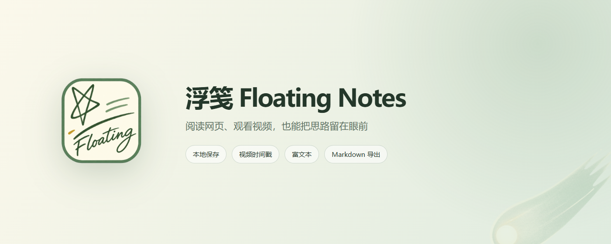
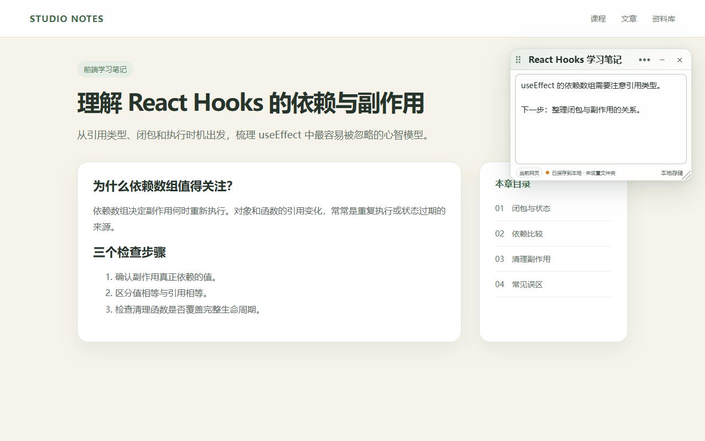
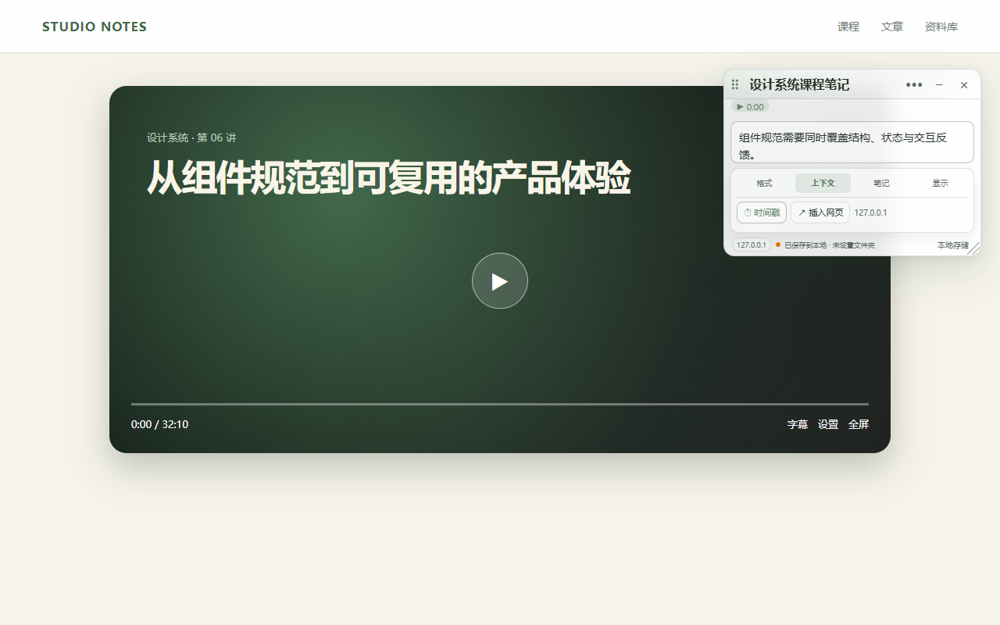

<div align="center">
  
  <h1>浮笺 Floating Notes</h1>
  <p>在网页与全屏视频上方记录本地笔记，让想法留在产生它的上下文中。</p>
  <p><strong>Local-first floating notes for Chrome and Edge.</strong></p>
</div>



## 功能亮点

- 网页内悬浮便签，滚动页面时保持可见；
- 可拖拽、缩放，并可折叠为可移动的流星图标；
- 多篇笔记、搜索、自动保存和恢复提示；
- 富文本：撤销/重做、粗体、斜体、下划线、删除线、列表、引用、代码块和颜色；
- 插入当前网页来源与 HTML5 视频时间戳，支持点击回跳；
- 输入区域隔离网页快捷键，避免在 YouTube 记笔记时空格误触暂停；
- 适配普通网页、播放器容器全屏和多数原生视频全屏场景；
- 背景透明度、文字透明度、字号和主题分别设置并持久化；
- 浏览器本地自动保存，可导出 Markdown 和 JSON；
- 用户主动授权后，可同步到本地 Markdown 文件夹；
- 中文、英文及跟随浏览器语言；
- Manifest V3，支持 Chrome、Edge 和其他 Chromium 浏览器。

## Screenshots

| 网页阅读笔记 | 视频时间戳 |
|---|---|
|  |  |

## 安装开发版

### Chrome

1. 下载或克隆本仓库；
2. 打开 `chrome://extensions/`；
3. 开启右上角“开发者模式”；
4. 点击“加载已解压的扩展程序”；
5. 选择本仓库根目录（其中应直接包含 `manifest.json`）；
6. 刷新安装前已经打开的网页。

### Edge

1. 打开 `edge://extensions/`；
2. 开启“开发人员模式”；
3. 点击“加载解压缩的扩展”；
4. 选择本仓库根目录。

## 默认快捷键

| 功能 | Windows / Linux |
|---|---|
| 显示或隐藏当前便签 | `Alt + Shift + N` |
| 新建笔记 | `Alt + Shift + M` |
| 开启或关闭鼠标穿透 | `Alt + Shift + P` |

如果快捷键与其他扩展冲突，请前往：

- Chrome：`chrome://extensions/shortcuts`
- Edge：`edge://extensions/shortcuts`

## 本地数据与 Markdown 同步

笔记首先保存在浏览器扩展的本地存储中。即使没有选择文件夹，或者文件夹权限暂时失效，浏览器中的笔记仍会保留。

若需要 Markdown 文件副本：

1. 在浮笺中打开完整设置；
2. 点击“选择文件夹”；
3. 在系统选择器中选择目标目录并授权；
4. 点击“立即同步全部笔记”检查同步。

浏览器不允许扩展在未经用户确认时静默访问任意磁盘路径。

## 隐私

- 默认不连接远程服务器；
- 不上传笔记、网页正文或浏览历史；
- 不读取密码输入框；
- 网页标题、URL 和视频进度仅在用户主动插入来源或时间戳时进入笔记；
- 本地文件夹必须由用户通过系统选择器主动授权。

完整隐私政策：[Floating Notes Privacy Policy](https://rongxilin50-star.github.io/floating-notes-privacy/)

## 已知限制

- 浏览器禁止扩展运行在 `chrome://`、`edge://`、扩展商店和其他受保护页面；
- 部分跨域 iframe、DRM、Canvas 或特殊播放器可能无法读取视频进度；
- F11 浏览器窗口全屏由浏览器控制，与网页元素全屏不同；
- 文件夹权限在浏览器重启后可能需要重新确认；
- 当前软删除笔记尚无可视化回收站；
- 多标签页冲突采用版本号优先策略，暂不提供逐行合并。

## 项目结构

```text
floating-notes/
├─ manifest.json          扩展清单、权限与快捷键
├─ service-worker.js      工具栏、命令、标签页状态与 Markdown 同步
├─ content.js             悬浮窗口、编辑器、笔记、视频与全屏交互
├─ keyboard-guard.js      网页快捷键隔离
├─ fullscreen-bridge.js   原生视频元素全屏兼容
├─ options.html/css/js    设置、目录授权与数据管理
├─ _locales/              中文和英文浏览器级文案
├─ icons/                 扩展图标与折叠流星
├─ docs/images/           README 展示图片
└─ .github/workflows/     自动语法与结构检查
```

## 开发与验证

本项目不依赖构建工具，浏览器直接加载源码。提交前可运行：

```bash
node -e "JSON.parse(require('fs').readFileSync('manifest.json', 'utf8'))"
node --check service-worker.js
node --check content.js
node --check keyboard-guard.js
node --check fullscreen-bridge.js
node --check options.js
```

GitHub Actions 会在推送和 Pull Request 时重复这些检查。

## 版本

当前版本：**V2.1.4**

变更记录见 [CHANGELOG.md](CHANGELOG.md)，测试范围见 [TEST_REPORT.md](TEST_REPORT.md)。

## 支持与安全

- 使用问题和功能建议：GitHub Issues
- 隐私或安全问题：`floatingnotes.cn@outlook.com`
- 发布者：**Lin Future Lab**

> 当前仓库尚未选择开源许可证。在许可证发布前，代码默认保留全部权利。

---

## English summary

Floating Notes is a local-first Chrome/Edge extension for taking rich-text notes over webpages and fullscreen videos. It supports multiple notes, webpage references, HTML5 video timestamps, independent opacity controls, Markdown export, optional local-folder synchronization, bilingual UI, and keyboard-event isolation for video learning workflows.

Notes stay in browser storage by default. No account or remote server is required.


